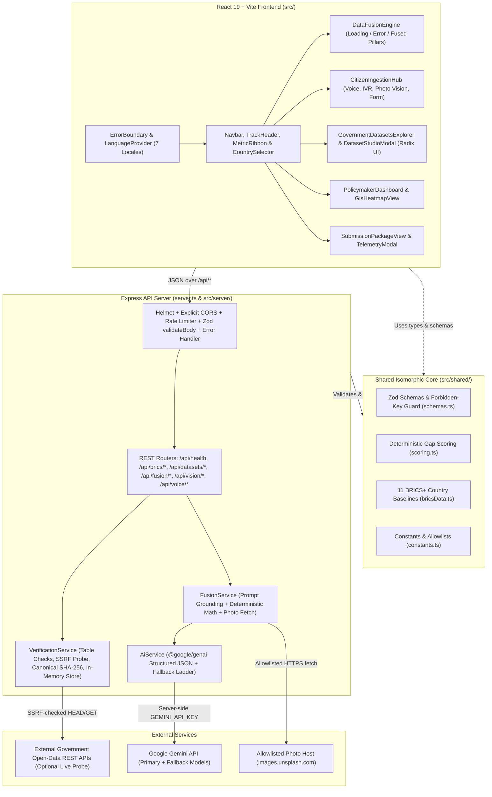
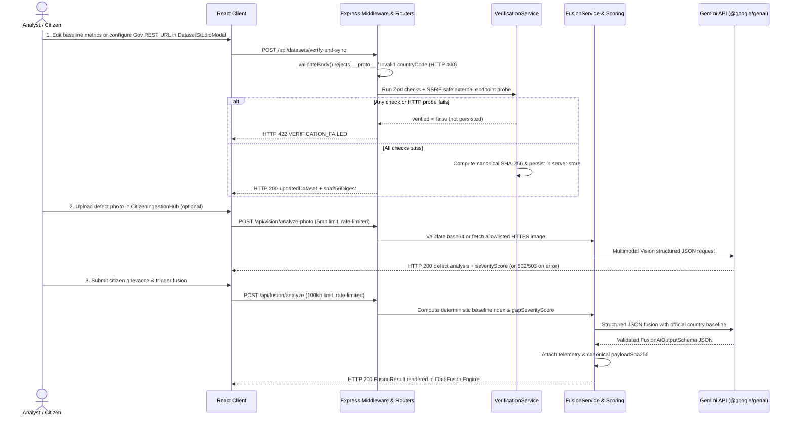

<div align="center">

# CivicPulse BRICS

**Multi-Jurisdictional AI Governance, Citizen Telemetry & Data-Fusion Platform for Digital Public Infrastructure**

[](./LICENSE)
[](https://www.typescriptlang.org/)
[](https://react.dev/)
[](https://bun.sh/)
[](./.github/workflows/ci.yml)

</div>

---

## Overview

Public infrastructure gaps across rapidly urbanizing and rural regions often go misprioritized because citizen complaints (voice calls, messaging reports, site photos) sit disconnected from official census statistics, infrastructure baseline indices, and public capital budgets.

**CivicPulse BRICS** bridges this divide as an open-source, Digital Public Good (DPG)-aligned governance workbench supporting the **11 BRICS+ nations** (`BR`, `RU`, `IN`, `CN`, `ZA`, `EG`, `ET`, `IR`, `SA`, `AE`, `ID`). It enables analysts and policymakers to:

1. **Ingest multimodal citizen grievances** via browser voice capture, toll-free IVR dialpad telemetry, messaging simulations, and site-defect photos analyzed with **Gemini Vision**.
2. **Maintain and verify sovereign baseline datasets** (demographics, infrastructure indices, public investment programs, and WHO/FAO/Copernicus feeds) with strict **Zod** validation, external REST API reachability probes, and reproducible **canonical SHA-256 digests**.
3. **Run AI-grounded cross-reference fusion** on an Express backend using `@google/genai` paired with deterministic sector gap scoring so every recommendation is grounded in verifiable baseline figures and returns explicit error states (`502`/`503`) if upstream AI services are unavailable.

---

## Key Features

- 🌐 **11 Sovereign BRICS+ Jurisdictions**: Instant switching across Brazil, Russia, India, China, South Africa, Egypt, Ethiopia, Iran, Saudi Arabia, UAE, and Indonesia (`BRICS_COUNTRY_CODES`).
- 🗣️ **Multilingual Interface (7 Languages)**: Built-in UI localization for English (`en`), Tamil (`ta`), Spanish (`es`), Portuguese (`pt`), Russian (`ru`), Arabic (`ar`), and Chinese (`zh`) via `LanguageContext`.
- 🎙️ **Multimodal Citizen Ingestion Hub**: Browser `MediaRecorder` voice capture with automatic timer/track cleanup, interactive IVR keypad simulator, WhatsApp/SMS webhook simulator, and infrastructure photo inspection via `POST /api/vision/analyze-photo`.
- 🛠️ **Official Dataset Studio & Live API Verification**: Radix UI-powered modal (`DatasetStudioModal`) with 6 schema tabs, preset loading, Zod-validated JSON import/export, and server-side verification (`POST /api/datasets/verify-and-sync`) that blocks persistence (`HTTP 422`) on any failed check.
- 🤖 **Deterministic Scoring + Grounded Gemini Fusion**: Combines deterministic sector baseline & gap-severity math (`src/shared/scoring.ts`) with structured `@google/genai` JSON generation and model fallback (`gemini-4-hydrogen` → `gemini-3.1-flash-lite`).
- 🔐 **Security & Honesty Guarantees**: Server-side `GEMINI_API_KEY` isolation, Helmet headers, explicit CORS policy, AI endpoint rate limiting (`20 req / 60s`), prototype-pollution key rejection (`__proto__`, `constructor`, `prototype`), SSRF-checked external probes, and reproducible `crypto.createHash('sha256')` payload digests.
- ♿ **Accessible Radix UI Design System**: White-surface institutional UI built with Tailwind CSS v4 and `@radix-ui` primitives (`Dialog`, `Tabs`, `Slider`, `DropdownMenu`), keyboard-reachable controls, and `aria-live` status banners.
- 📊 **Policymaker Hotspots, GIS Overlay & Pitch Package**: Sector-filtered policy recommendations, interactive spatial demand hotspot overlays, JSON DPG telemetry inspector, and a 12-slide evaluation package.

---

## Tech Stack

| Layer             | Technologies                                                                                                                                                                    |
| :---------------- | :------------------------------------------------------------------------------------------------------------------------------------------------------------------------------ |
| **Frontend**      | React 19, TypeScript 5.8 (`strict`, `noUncheckedIndexedAccess`, `noUnusedLocals`), Vite 6, Tailwind CSS v4, Radix UI (`Dialog`, `Tabs`, `Slider`, `DropdownMenu`), Lucide React |
| **Backend**       | Node.js / Express 4, `@google/genai`, Zod 4, Helmet, CORS, `express-rate-limit`, `dotenv`                                                                                       |
| **Shared Domain** | Isomorphic TypeScript types, Zod schemas, deterministic gap-scoring functions, 11-country baseline dataset                                                                      |
| **Tooling & QA**  | Bun 1.4+, Vitest 5, `@vitest/coverage-v8`, React Testing Library, Supertest, ESLint 10 (`typescript-eslint`, `react-hooks`, `jsx-a11y`), Prettier 3, GitHub Actions             |

---

## Architecture Diagram



---

## End-to-End Workflow



---

## Project Structure

```text
.
├── .github/workflows/ci.yml             # GitHub Actions Bun CI pipeline (lint, format, coverage, build)
├── docs/API.md                          # Complete REST API contract & error code documentation
├── public/favicon.ico                   # Browser favicon served statically by Vite / Express
├── server.ts                            # HTTP bootstrap (env config, API mounting, Vite dev / dist prod)
├── index.html                           # Root HTML entry point with SEO/OpenGraph metadata
├── package.json                         # Runtime/dev dependencies and Bun/Vite/Vitest scripts
├── tsconfig.json                        # Strict TypeScript compiler configuration
├── eslint.config.js                     # ESLint 10 flat config (typescript-eslint, react-hooks, jsx-a11y)
├── vitest.config.ts                     # Vitest & V8 coverage configuration
├── vite.config.ts                       # Vite + React + Tailwind v4 configuration
├── .env.example                         # Environment variable template (no hardcoded secrets)
├── .gitignore                           # Git ignore rules (.env, dist, coverage, node_modules)
├── .prettierignore / .prettierrc        # Prettier formatting rules
├── LICENSE                              # MIT License
├── CONTRIBUTING.md                      # Contributor setup & engineering standards
└── src/
    ├── main.tsx                         # React 19 entry point wrapped in ErrorBoundary & LanguageProvider
    ├── App.tsx                          # Root application state, tab routing, and abortable fusion requests
    ├── index.css                        # Tailwind CSS v4 stylesheet entry
    ├── lib/utils.ts                     # Classname merge helper (clsx + tailwind-merge)
    ├── context/LanguageContext.tsx      # 7-language translation context & selector metadata
    ├── test/setup.ts                    # Vitest + jest-dom test setup
    ├── shared/
    │   ├── constants.ts                 # Country allowlist, forbidden keys, scoring/body/rate constants
    │   ├── types.ts                     # Isomorphic domain, API, verification, and fusion interfaces
    │   ├── schemas.ts                   # Zod schemas & recursive prototype-pollution checker
    │   ├── scoring.ts                   # Deterministic sector baseline, gap severity & program matching
    │   ├── bricsData.ts                 # Baseline datasets for 11 BRICS+ nations, hotspots & sample cases
    │   └── __tests__/                   # Unit tests for Zod schemas and gap scoring
    ├── server/
    │   ├── app.ts                       # Express app factory (Helmet, dynamic CORS, routers, 404, errors)
    │   ├── config.ts                    # Fail-fast Zod environment parser & Gemini model sanitizer
    │   ├── errors.ts                    # Typed HTTP errors (400, 404, 422, 502, 503)
    │   ├── logger.ts                    # JSON structured logger (debug / info / warn / error)
    │   ├── middleware/
    │   │   ├── errorHandler.ts          # Global error & 404 JSON handler (never leaks raw 500 stack)
    │   │   ├── rateLimit.ts             # Sliding-window rate limiter for AI endpoints
    │   │   └── validate.ts              # Zod request body validator & forbidden-key blocker
    │   ├── routes/
    │   │   ├── health.ts                # GET /api/health
    │   │   ├── brics.ts                 # GET /api/brics/countries & POST /api/datasets/verify-and-sync
    │   │   ├── fusion.ts                # POST /api/fusion/analyze
    │   │   ├── vision.ts                # POST /api/vision/analyze-photo
    │   │   └── voice.ts                 # POST /api/voice/process-ivr
    │   ├── services/
    │   │   ├── ai.ts                    # @google/genai structured JSON wrapper & model fallback ladder
    │   │   ├── fusion.ts                # Data fusion prompt grounding, image fetch, IVR telemetry
    │   │   └── verification.ts          # Table-driven checks, SSRF-checked probes, canonical SHA-256
    │   └── __tests__/                   # Integration & service tests (Supertest, AI, config, verification)
    └── components/
        ├── ErrorBoundary.tsx            # Root React error fallback with workspace reset
        ├── TrackHeader.tsx              # Evaluation track banner
        ├── Navbar.tsx                   # Responsive navigation bar, language dropdown & telemetry button
        ├── MetricRibbon.tsx             # Active country census/budget/ingestion KPI summary strip
        ├── CountrySelector.tsx          # 11-country BRICS+ selector bar
        ├── PolicymakerDashboard.tsx     # Priority project recommendations & ranked demand hotspots
        ├── GisHeatmapView.tsx           # Regional hotspot coordinates & layer overlay view
        ├── TelemetryModal.tsx           # Accessible Radix Dialog for inspecting/downloading JSON telemetry
        ├── ui/                          # Radix UI primitives (dialog, dropdown-menu, slider, tabs, styles)
        ├── data-fusion/                 # Fusion header, pipeline steps, 3-pillar cards & provenance audit
        ├── citizen-ingestion/           # Voice/Photo/Messaging tabs, IVR dialpad, grievance form & hooks
        ├── datasets-explorer/           # Repository cards & quick API verification hook
        ├── dataset-studio/              # 6-tab verification studio modal, fields, presets & hooks
        ├── submission-package/          # Build checklist, 12-slide deck, demo script & submission kit
        └── __tests__/                   # React Testing Library component & hook test suite
```

---

## Installation & Setup

### Prerequisites

- **Bun** `>= 1.2` ([install Bun](https://bun.sh))
- **Node.js** `22.x` (used alongside Bun for local tooling compatibility)
- A **Google Gemini API Key** (`GEMINI_API_KEY`) for live AI fusion and vision endpoints (all offline tests and dataset verification routes work without a key)

### 1. Clone & Install

```bash
git clone https://github.com/your-org/civicpulse-brics.git
cd civicpulse-brics
bun install --frozen-lockfile
```

### 2. Configure Environment Variables

```bash
cp .env.example .env
```

Edit `.env`:

| Variable                 | Required             | Default                  | Description                                                                          |
| :----------------------- | :------------------- | :----------------------- | :----------------------------------------------------------------------------------- |
| `PORT`                   | No                   | `3000`                   | HTTP port bound by Express (`1`–`65535`).                                            |
| `NODE_ENV`               | No                   | `development`            | `development`, `production`, or `test`.                                              |
| `LOG_LEVEL`              | No                   | `info`                   | Structured logger threshold: `debug`, `info`, `warn`, `error`.                       |
| `GEMINI_API_KEY`         | For AI routes / prod | `""`                     | Server-side Google GenAI key. Never exposed to the browser.                          |
| `REQUIRE_GEMINI_API_KEY` | No                   | `false` (`true` in prod) | Fails server startup if `GEMINI_API_KEY` is missing.                                 |
| `GEMINI_MODEL_PRIMARY`   | No                   | `gemini-4-hydrogen`      | Primary Gemini model for structured JSON fusion.                                     |
| `GEMINI_MODEL_FALLBACKS` | No                   | `gemini-3.1-flash-lite`  | Comma-separated fallback Gemini models.                                              |
| `GEMINI_VISION_MODEL`    | No                   | `gemini-4-hydrogen`      | Gemini model used for `/api/vision/analyze-photo`.                                   |
| `CORS_ORIGIN`            | No                   | `""`                     | Comma-separated allowed origins (same-origin & localhost dev allowed automatically). |
| `APP_URL`                | No                   | `""`                     | Optional hosted origin allowed by CORS policy.                                       |

### 3. Run Locally

```bash
# Development server (Express API + Vite SPA middleware on http://localhost:3000)
bun run dev

# Verification suite (lint, formatting, unit/integration tests + coverage, production build)
bun run lint
bunx prettier --check .
bun run test:coverage
bun run build

# Run compiled production server (serves dist/ + /api/*)
bun run start
```

---

## Usage Guide & API Examples

### 1. Verify & Sync a Country Dataset (`POST /api/datasets/verify-and-sync`)

Checks demographic totals (`ruralPercentage + urbanPercentage <= 100`), infrastructure bounds, and active capital programs, optionally probes an external government REST endpoint (blocking private/loopback/metadata IPs), and computes a canonical SHA-256 digest before saving.

**Sample Request**

```bash
curl -X POST http://localhost:3000/api/datasets/verify-and-sync \
  -H "Content-Type: application/json" \
  -d '{
    "countryCode": "IN",
    "dataset": {
      "code": "IN",
      "name": "India",
      "nativeName": "Republic of India",
      "flag": "🇮🇳",
      "capital": "New Delhi",
      "populationMillions": 1428.6,
      "openDataPortalName": "Data.gov.in (National Data Platform)",
      "openDataPortalUrl": "https://data.gov.in",
      "censusAgency": "Office of the Registrar General & Census Commissioner / MoSPI",
      "primaryLanguages": ["English", "Hindi", "Tamil"],
      "sampleRegions": ["Tamil Nadu (Madurai / Tirunelveli)"],
      "demographics": {
        "totalPopulation": "1,428,627,663",
        "ruralPercentage": 64.9,
        "urbanPercentage": 35.1,
        "densityPerKm2": 435,
        "vulnerableDemographicIndex": 42.8,
        "literacyRate": 77.7
      },
      "infrastructureIndex": {
        "pavedRoadScore": 68.4,
        "waterSanitationCoverage": 74.2,
        "healthCentersPer10k": 1.4,
        "broadbandConnectivity": 62.5,
        "powerGridReliability": 91.2
      },
      "publicInvestment": {
        "fiscalYear": "2025-2026",
        "totalBudgetUSD": "$134.2 Billion",
        "allocatedProjectsCount": 4280,
        "disbursementRate": 68.4,
        "topPrograms": [
          {
            "name": "Jal Jeevan Mission (Har Ghar Jal)",
            "budgetUSD": "$8.4 Billion",
            "sector": "Water & Sanitation",
            "status": "On Track"
          }
        ]
      },
      "publicDataFeeds": {
        "whoHealthIndex": 72.1,
        "faoAgriWaterStress": 66.5,
        "copernicusSatelliteHeatScore": 84.3,
        "meteorologicalAlertLevel": "Advisory"
      }
    }
  }'
```

**Sample Response (`200 OK`)**

```json
{
  "success": true,
  "verificationResult": {
    "verified": true,
    "timestamp": "2026-11-21T08:00:00.000Z",
    "checksPassed": 4,
    "checksTotal": 4,
    "sha256Digest": "sha256:9f86d081884c7d659a2feaa0c55ad015...",
    "checks": [
      {
        "id": "demographics_schema",
        "name": "Demographic Census Integrity",
        "passed": true,
        "message": "Census metrics valid: Pop 1,428,627,663, Rural/Urban 64.9%/35.1%, Density 435/km².",
        "severity": "success"
      }
    ],
    "endpointStatus": { "probed": false },
    "appliedToState": true
  },
  "updatedDataset": { "code": "IN", "sha256Digest": "sha256:9f86d081884c7d659a2feaa0c55ad015..." }
}
```

### 2. Run AI Data Fusion (`POST /api/fusion/analyze`)

**Sample Request**

```bash
curl -X POST http://localhost:3000/api/fusion/analyze \
  -H "Content-Type: application/json" \
  -d '{
    "countryCode": "IN",
    "grievance": {
      "id": "GRV-IN-1001",
      "region": "Tamil Nadu (Madurai)",
      "channel": "Voice IVR",
      "originalText": "Main drinking water pipeline ruptured in Melur affecting 12 villages.",
      "originalLanguage": "Tamil",
      "sector": "Water & Sanitation",
      "urgency": "Emergency"
    }
  }'
```

**Sample Error When Key Is Unconfigured (`503 Service Unavailable`)**

```json
{
  "success": false,
  "error": {
    "code": "AI_SERVICE_UNAVAILABLE",
    "message": "Gemini AI service is not configured. Set GEMINI_API_KEY on the server."
  }
}
```

See [docs/API.md](./docs/API.md) for full contracts covering `/api/health`, `/api/brics/countries`, `/api/vision/analyze-photo`, and `/api/voice/process-ivr`.

---

## Screenshots & Demo

> Add your captured screenshots or GIF recordings to `docs/screenshots/` before tagging a release:

| View                                       | Preview Placeholder                                                |
| :----------------------------------------- | :----------------------------------------------------------------- |
| **AI Data Fusion Engine**                  | ``     |
| **Dataset Studio & Live API Verification** | ``     |
| **Multimodal Citizen Ingestion Hub**       | `` |
| **Policymaker Hotspots & GIS Overlay**     | ``  |

---

## Roadmap & Known Limitations

### Current Limitations (Accurate Scope)

- **In-Memory Store**: Country dataset updates verified via `POST /api/datasets/verify-and-sync` persist in server memory (`VerificationService`) for the lifetime of the running process rather than an external database.
- **Simulated Telephony & Messaging Gateways**: Browser microphone capture uses the Web `MediaRecorder` API with a timed fallback, while the toll-free IVR dialpad and WhatsApp webhook panel are client/server simulators (not connected to live carrier SIP trunks).
- **Static Regional GIS & Policymaker Baseline Tables**: `GisHeatmapView` and `PolicymakerDashboard` display curated multi-country regional hotspot tables rather than live external tile/GIS servers.

### Planned Improvements

- [ ] Add optional PostgreSQL / Firestore persistence for verified sovereign datasets and submitted grievances.
- [ ] Split client bundle chunks (`manualChunks` in `vite.config.ts`) to keep the production client JS bundle under 500 kB.
- [ ] Add DNS-resolution rebinding checks (`dns.lookup` verification prior to outbound socket connection) on external open-data API probes.
- [ ] Connect live SIP/Twilio IVR webhooks and real-time GeoJSON layers.

---

## Contributing

Contributions are welcome! Please read [CONTRIBUTING.md](./CONTRIBUTING.md) and ensure `bun run lint`, `bunx prettier --check .`, `bun run test:coverage`, and `bun run build` pass before opening a pull request.

## License

Licensed under the [MIT License](./LICENSE).

## Author & Contact

- **Maintainer**: CivicPulse BRICS Maintainers (`nagarajan1320@gmail.com`)
- **Documentation**: [API Reference](./docs/API.md)
